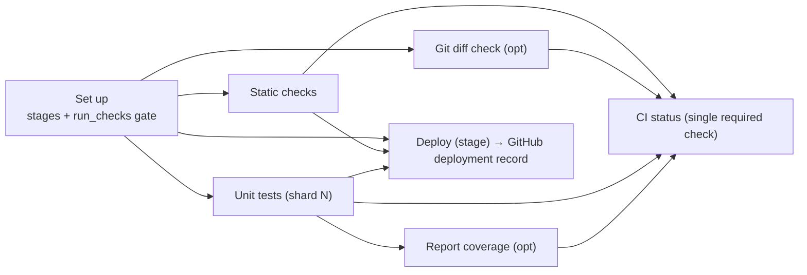

# CI skeleton: design (DRAFT, PF-2646 / PF-2682)

Applied in this repo as `.github/workflows/backend.yml` (callers keep that path; the workflow `name` stays `Backend CI`). The text below was drafted against a file called `skeleton.yml`; that name means `backend.yml` here. Org action refs in the workflow are `@master` until a `v1` tag exists.

**Principle: simplify what already exists. This is not a new framework.** `backend.yml` is the previous
`actions/.github/workflows/backend.yml` (origin/master, PR #348 + #353, cited below as **B:line**)
with cuts, fixes and two small hooks. The job graph and job names stay the same. Other sources: shiva `default.yml` (**S:**), scrooge `pr-checks.yml` (**R:**),
smoke/deploy files, and the **unmerged** frontend workflow `latest/frontend.feat-branch.yml`
(**F:**, branch feat/frontend-ci-workflow, Aug 20).

## 1. Layers (kept thin)
| Layer | What | New code? |
|---|---|---|
| (a) Skeleton | `.github/workflows/backend.yml`: one reusable workflow. setup → static-checks + diff-check + tests → report-coverage → deploy, plus a `ci-status` roll-up | Evolves B in place. A `v1` tag is a follow-up; refs are `@master` until then |
| Runtime hook | `runtime` + `version_file` + `install_command` + `run_prefix` inputs. One composite, `setup-runtime`, dispatches node/python/go/java | One composite (`packages/setup-runtime/action.yml`) |
| (b) Presets | **The input defaults are the backend-node preset.** No separate preset files until a second stack needs them | None |
| (c) Existing actions | get-deployment-stages, fail-on-code-and-migrations, check-iam-wildcards, jest-coverage, bobheadxi/deployments | Reused unchanged |

Optional "scan" and a separate "build" job are **not added**. The build already runs inside
static-checks (B:231-235). Add a job only when a real consumer exists (YAGNI).

## 2. Job graph

`deploy` only creates a deployment record (B:428-439) using OSOME_BOT_TOKEN. The repo's own
`deploy.yml` / `deploy-application.yml` runs `on: deployment` and does the real deploy.
The skeleton keeps that handoff. It does not absorb deploy logic. The per-env concurrency
group on that job only serializes creation of the deployment record. It does not guarantee
the newest commit is what the app deploy workflow ships; see GAPS.md.

## 3. Remove / Simplify / Optimize
| # | Today (cite) | Change in backend.yml | Why |
|---|---|---|---|
| 1 | read-nvmrc + setup-node + `.npmrc` block repeated in 3 jobs (B:177-201, 314-333, 380-399) | One `setup-runtime` step | -45 lines; also the runtime hook |
| 2 | report-coverage does checkout + Node + `npm ci` (B:374-399) | Node and `npm ci` removed. Checkout stays, because jest-coverage `require()`s `./jest.config.js` for `coverageThreshold`. The action itself is bundled node24 (`packages/jest-coverage/action.yml:19-20`) | Saves the install. A config that `require()`s an installed package would still need `node_modules` |
| 3 | Skip guard copied 3× as `contains(github.ref,'refs/heads/main')` (B:151,241,261) | Computed once in setup as an `run_checks` output, matched exactly against `default_branch` | One source. Substring also matched `refs/heads/main-*` |
| 4 | Workflow concurrency `cancel-in-progress: true` for every event (B:125-127) | `cancel-in-progress: ${{ github.event_name == 'pull_request' }}`; non-PR group keyed on run_id | PF-2686: never cancel main/tag/deploy (see §5) |
| 5 | Deploy `if: always() && …` (B:423) | `!cancelled() && needs.setup.result=='success' && …` | always() lets a *cancelled* run still create a deployment |
| 6 | `deployments: write` on static-checks/tests (B:159,269) | Dropped. bobheadxi uses OSOME_BOT_TOKEN, not GITHUB_TOKEN | Least privilege |
| 7 | No top-level `permissions:` (B whole file) | `permissions: contents: read`, raised per job | Least privilege |
| 8 | `secrets: inherit` (B:14,118-120) | Explicit `secrets:` block (4 secrets) | Rollout requirement. Smaller blast radius |
| 9 | Composite refs `@master` (B:141,162,220,410) | Intended: `@v1` tag on the actions repo (or SHA). Landed as `@master` because no `v1` tag exists yet | Reproducible once tagged. Rollback by pin |
| 10 | checkout@v4 (B:165,302,375) mixed with @v6 (B:248). Pilots use v6/v7/v8 (S:57,203,241) | All pinned by commit SHA at v4 (PF-2684 wording) | Consistency (see open Q1) |
| 11 | `role-session-name: ${{ github.repository.id }}` (B:174,311). `github.repository` is a string, so this is empty | `gha-${{ github.repository_id }}`, as scrooge already does (R:74) | Bug fix |
| 12 | aws-actions pin `e3dd6a42…` (B:171) vs pilots' `acca2b1b… # v6` (S:62) | Pilots' v6 SHA | One pin |
| 13 | `mv coverage-final.json` unconditional (B:355) | Behind `report_coverage`. Scrooge has no coverage (R:174-175) | Lets scrooge adopt without hacks |
| 14 | Header claims "npm + jest caching" (B:18), but there is no jest cache step | Keep the npm cache (setup-node `cache: npm`). Jest cache stays opt-in later | Don't claim what isn't there |
| 15 | styfle/cancel-workflow-action in setup (S:30-33, R:31-34) | Removed from callers. Concurrency replaces it | One mechanism |
| 16 | Per-job required checks | `ci-status` roll-up (from F:304-315) | One required check, stable across shard counts |
| 17 | Artifacts kept 90d by default (B:359-362) | `retention-days: 3`, `overwrite: true` (re-run safe) | Storage |
| 18 | Postgres/redis always started (B:272-295) | `services` input. An empty image skips the container | Frontend/mobile/non-DB backends |

## 4. Inputs / outputs contract
| Input | Default (= backend-node preset) | Notes |
|---|---|---|
| runtime / version_file | node / .nvmrc | → setup-runtime (node, python, go, java) |
| install_command / run_prefix | `npm ci` / `npm run` | Every script runs as `$run_prefix <script>` (yarn run, make, poetry run …) |
| static_check_scripts | unused-exports type-check lint depcheck type-coverage spell | Same as B:68-74 and shiva's step order (S:89-105) |
| lockfile_check | true | node only. `npm install` + diff (B:191-201) |
| build_script / serverless_license | build / true | Empty build skips both |
| run_iam_check / run_migration_guard | true / true | Existing composites |
| test_script / migrate_script | test:ci / db:migrate:test | Empty migrate skips |
| shards / enable_sharding / report_coverage | `[1,2,3]` / true / true | |
| services, services_registry, postgres_image, redis_image, db_name | true, '', postgres:16.11, redis:7.0.7, app-test | Same as B:29-48 |
| run_diff_check / diff_check_script | true / bin/checkBranchDiff.js | PF-3243 (see §10) |
| default_branch | main | Gate (row 3) |
| aws_region / dev_role_arn | us-east-1 / github-deployer-nokms | |
| light_runner / heavy_runner | arc-runner-light / arc-runner-heavy | heavy default per PR #353 |
| **Secrets** | OSOME_BOT_TOKEN, NPMJS_KEY_READ_ONLY, DOCKER_CACHE_USER, DOCKER_CACHE_PASSWORD. Declared, none `required`, so existing `secrets: inherit` callers are not rejected at startup. New callers should pass them explicitly | |
| **Outputs** | `stages` (JSON), `run_checks` ('true'/'false') | Lets callers chain extra jobs |

## 5. Concurrency and skip guard
- **Callee vs caller.** A reusable workflow's top-level `concurrency` applies to the called
  run, and the caller's workflow-level `concurrency` applies to the caller run. Both are
  evaluated, so if they share a group name the run deadlocks (shiva deploy.yml:43-44 says this
  explicitly). Inside the callee, `github.*` is the **caller's** context: `github.workflow` is the
  caller's name (CI / PR checks), so the group is unique per caller workflow. **Decision:**
  concurrency lives only in the callee, and callers declare none. One more reason: a caller job
  skipped by `if:` (scrooge title edits) never enters the group, so it cannot cancel a real run.
- **Group:** `ci-skeleton-<caller workflow>-<ref on PR | run_id otherwise>`. PRs cancel superseded
  runs. Tags, main and repository_dispatch runs of **this skeleton** are never cancelled (PF-2686).
  Keying those on `run_id` also keeps GitHub's one-pending-per-group rule from dropping a queued
  skeleton run. It does not order the app repo's `on: deployment` workflow; see GAPS.md.
  *Pending Stef's approval.*
- **Smoke (PF-3080):** smoke.yml keeps its own `smoke-pr-<n>` group with `cancel-in-progress: false`
  (S smoke.yml:7-9) and the per-env `smoke-<repo>-<env>` group with `queue: max` (smoke.yml:33-36).
  The skeleton never touches these group names. No conflict.
- **Skip guard:** GitHub has no workflow-level `if:`. The "workflow-level gate" (PF-2684) has
  two parts. (1) Event filters stay in the caller's `on:` and its single `uses:` job `if:`
  (scrooge's edit filter, R:24). (2) Inside the skeleton, one computed `run_checks`. Deploy
  intentionally runs on tags/dispatch with the gates skipped (unchanged behaviour, B:423).

## 6. Permissions and secrets
- Skeleton top level: `contents: read`. Raised per job: setup gets `pull-requests: read`;
  static-checks gets `id-token: write` + `pull-requests: read` (OIDC, changed-files REST); tests
  gets `id-token: write`; deploy and ci-status get `{}`.
- The caller must grant a **superset** (`contents: read, id-token: write, pull-requests: read`).
  If it grants a subset, the run fails at startup with no check run (smoke.yml:29-32 trap).
  Callers set this at workflow level.
- Secrets are passed explicitly (see callers). Nothing new: these are exactly the 4 that B
  already reads.

## 7. Runner tiers, caching, artifacts, timeouts
- Tiers: light = setup, diff-check, report-coverage, deploy, ci-status. heavy = static-checks,
  tests (B:105-117 profiling). F adds `arc-runner-medium` for install + lint (F:107-111). Not
  adopted for backend until it is measured (PF-2683 baseline).
- Caching: setup-node `cache: npm` (≈ B:189), pip/gradle via setup-runtime. No other caches.
- Artifacts: `<kind>-<discriminator>`, e.g. `coverage-artifacts-<shard>` (name unchanged). Uploaded
  in tests, downloaded with pattern + merge in report-coverage (PF-2688: covered end to end).
  upload and download are pinned to the same major.
- Timeouts (PF-2958): every job has one. setup 10, static 15, diff 10, tests 30, coverage 15,
  deploy 10 (was 30, B:422; it is a single API call), ci-status 2.

## 8. Smoke traps (must not break)
- Never name a skeleton job `smoke`. A skipped job named like a required check passes it
  (smoke.yml:25). The skeleton's names are Set up, Static checks, Git diff check, Unit tests,
  Report coverage, Deploy, CI status.
- `!cancelled()` guards: deploy.yml uses `!cancelled() && needs.setup.result=='success'`
  (deploy.yml:146-148). The skeleton uses the same idiom in deploy and ci-status, with an explicit
  success check because `!cancelled()` drops the implicit `success()`.
- Permissions superset: see §6. The skeleton requests no `deployments`/`statuses`, so the smoke
  callers' grants (smoke.yml:27-32) are unaffected. smoke.yml does not call the skeleton.
- scrooge `smokeWorkflow.test.ts` contract: the file is **not in the copied material** (only
  `.github/` was copied), so its assertions can't be checked. Smoke and deploy files are unchanged
  by this design, but someone must run that test on the migration PR.

## 9. Versioning and rollout
Tag the actions repo `v1` (moving major tag) plus immutable `v1.x.y`. Callers pin `@v1`, or
`@v1.x.y` for Renovate/Dependabot bumps. **That tag does not exist yet**, so `backend.yml` and
the example callers reference `@master`. Rollback until the tag exists: revert this PR, or
callers pin the previous commit SHA of `backend.yml`. After the tag exists, rollback is
re-pointing `v1` or pinning the previous `v1.x.y`. Pilot order: shiva, then scrooge, then the
remaining repos that use backend.yml-style CI. Update branch protection in the **same window**
as each caller merges (§11, GAPS.md).

## 10. Frontend and mobile, and what is common with frontend.yml (unmerged)
Shared with F, nearly line for line: setup = get-deployment-stages only (F:129-141 ≈ B:133-144);
the static-check script loop via env + xargs (F:174-187 ≈ B:203-216); lockfile-clean install
(F:159-172 ≈ B:191-201); tests job; the same tag/main skip guard (F:146 ≈ B:151); the same
concurrency (F:120-122 ≈ B:125-127); light/heavy tiers; `secrets: inherit`; the branch-diff
gate (F:291-302 ≈ B:237-257). Frontend-only: build job, storybook, Playwright e2e with browser
cache, `package_manager`, NODE_OPTIONS, medium tier, and the `ci-status` roll-up.
**Plug-in path:** the frontend calls the same skeleton with `services: false`, `migrate_script: ''`,
`serverless_license: false`, `run_prefix: yarn run` (osome-com), and `run_iam_check:false`,
`run_migration_guard:false`. Then add exactly two optional jobs when it is adopted: `e2e` (from
F:241-289) and `build` artifacts. Mobile: `runtime: java` (Android/gradle). iOS needs macOS
runners plus Ruby/Xcode, which setup-runtime does not cover. **Not designed yet.**
Problems in F to fix before merging it: timeouts only on e2e (F:246, violates PF-2958); inputs
spliced into `run:` (F:163,208,211,235, an injection surface its own comment warns about at
F:175-177); no permissions; `@master` refs.
**Diffchecker (PF-3243):** both stacks call a repo-local `bin/checkBranchDiff.js`. The backend
passes MAX_LINES with checkout depth 1 (B:247-257). The frontend uses `fetch-depth: 0` with no
argument (F:297-302). Proposal: move the script into `actions/packages/diff-check`
(composite: checkout fetch-depth 0 + script), so repos no longer carry it. The script's source is
not in the copied material, so the depth requirement is **undetermined**.

## 11. Required status checks
Reusable-workflow check names become `<caller job> / <callee job name>`. So **every** current
check name changes, e.g. `Static checks` → `ci / Static checks`, `Unit tests (3)` →
`ci / Unit tests (3)`. Recommendation: require only **`ci / CI status`** (plus the existing
`smoke`). The per-pilot mapping is in GAPS.md. Which checks are *currently* required can't be
determined from files; it needs repo settings (branch protection API).

## 12. Open questions for Stef
1. PF-2684 says pin checkout/setup-node/artifact **@v4**, but the pilots already run v6/v7/v8 and
   B:248 uses checkout@v6. Pinning v4 is a downgrade for the pilots. Which major?
2. Approve the concurrency design (§5).
3. Services: pilots use `osomecache…/postgres:latest` (S:137, R:126). With `services_registry` the
   skeleton uses `:16`. Is that acceptable for both pilots?
4. Do shiva and scrooge have `bin/checkBranchDiff.js`? Callers currently set `run_diff_check: false`.
5. Should `ci-status` become the only required check? Should `Add PR labels` (scrooge) leave CI?
6. Rename backend.yml in place (same file, v1 tag) or add skeleton.yml next to it? This PR keeps the file in place as `backend.yml`. The `v1` tag is still open.
